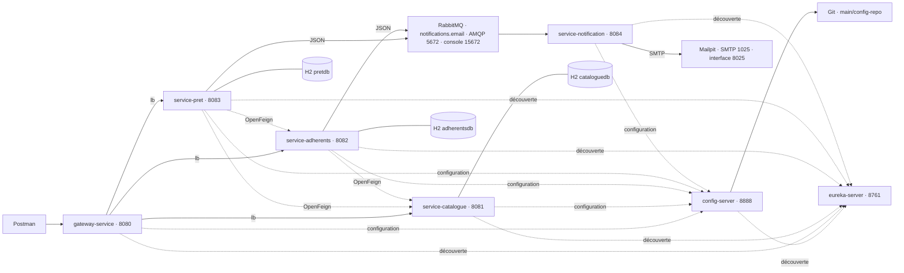
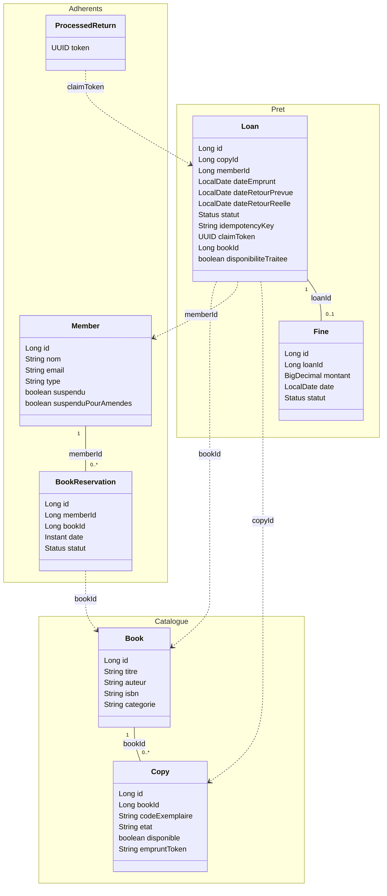

# Biblio-Share

Biblio-Share gère les ouvrages, exemplaires, adhérents, réservations, emprunts et amendes d’une bibliothèque. Le retour d’un exemplaire peut déclencher un email pour la première réservation en attente. La détection d’un retard crée une amende et déclenche une notification par email.

## Architecture



## Modèle



Les flèches en pointillés désignent des références par identifiant entre services. Chaque service métier a sa propre base H2 en mémoire. Le redémarrage d’un service métier efface ses données locales. Pour redémarrer une démonstration complète, redémarrer les trois services métier ensemble puis rejouer les données de départ.

## Démarrage sous PowerShell

Prérequis actuels du projet · JDK 17, Maven, Docker Desktop avec Compose, Postman. Exécuter les commandes depuis la racine. Démarrer Docker Desktop avant Compose.

```powershell
java -version
mvn verify
docker compose up -d --wait
```

Démarrer chaque commande dans son propre terminal. Attendre le démarrage de Config Server et Eureka avant les services clients.

```powershell
java -jar eureka-server/target/eureka-server-1.0.0-SNAPSHOT.jar
```

Dans un deuxième terminal, définir l’URI du dépôt Git et démarrer Config Server.

```powershell
$env:CONFIG_GIT_URI = ([uri](Get-Location).Path).AbsoluteUri
java -jar config-server/target/config-server-1.0.0-SNAPSHOT.jar
```

Vérifier `http://localhost:8888/service-catalogue/default`, puis lancer les cinq clients dans leurs terminaux respectifs.

```powershell
java -jar service-catalogue/target/service-catalogue-0.0.1-SNAPSHOT.jar
java -jar service-adherents/target/service-adherents-1.0.0-SNAPSHOT.jar
java -jar service-pret/target/service-pret-1.0.0-SNAPSHOT.jar
java -jar service-notification/target/service-notification-1.0.0-SNAPSHOT.jar
java -jar gateway-service/target/gateway-service-1.0.0-SNAPSHOT.jar
```

Si OneDrive verrouille les anciens dossiers générés, utiliser un chemin de compilation neuf, par exemple `mvn verify '-Dbiblio.build.directory=target/remise'`. Ajouter alors `/remise` après `/target` dans les chemins des JAR.

| Composant | Adresse locale |
| --- | --- |
| Eureka | http://localhost:8761 |
| Configuration du catalogue | http://localhost:8888/service-catalogue/default |
| Gateway | http://localhost:8080/service-catalogue/books |
| Catalogue | http://localhost:8081/books |
| Adhérents | http://localhost:8082/members |
| Emprunts | http://localhost:8083/loans |
| Notification | http://localhost:8084/actuator/health |
| RabbitMQ Management | http://localhost:15672 (guest / guest) |
| Mailpit | http://localhost:8025 |

`docker compose ps` affiche l’état de RabbitMQ et Mailpit. `docker compose stop` les arrête en conservant le volume RabbitMQ.

### Configuration centralisée

Config Server utilise le backend Git et cherche sous `config-repo` sur `main`. `CONFIG_GIT_BRANCH` permet de sélectionner une autre branche. Pour une démonstration locale, utiliser un clone propre ou réserver un clone à la configuration et le mettre à jour à partir des commits. Avec une URI vers un serveur Git, Config Server maintient sa propre copie. Vérifier le SHA `version` et les deux entrées de `propertySources` avant de lancer les clients.

Chaque client charge les propriétés globales et celles de son application au démarrage. `CONFIG_SERVER_URL` permet de déplacer Config Server. Eureka et Config Server conservent leurs paramètres d’amorçage locaux.

## Démonstration V1 à V6

Importer `postman/Biblio-Share.postman_collection.json` dans Postman. Laisser les variables créées lors d’une étape disponibles pour les suivantes.

```powershell
npx.cmd newman@6.2.3 run postman/Biblio-Share.postman_collection.json
```

Attendre les six applications `UP` dans Eureka et vérifier un premier appel via Gateway. La collection attend la livraison SMTP après le retour. Pour les requêtes de panne, définir `outage` à `catalogue` ou `adherents`, arrêter le service choisi et lancer le sous-dossier des pannes avec les variables du parcours nominal.

1. **V1.** Exécuter le dossier CRUD. Les requêtes de suppression créent et suppriment leurs propres ressources. Le livre, l’exemplaire et l’adhérent principaux sont conservés pour V4.
2. **V2.** Attendre la propagation du registre Eureka, puis exécuter les requêtes Gateway. Le préfixe `/service-catalogue` ou `/service-adherents` sélectionne le service par son nom dans Eureka.
3. **V3.** Afficher la configuration de chaque service et vérifier les deux niveaux de propriétés ainsi que le port spécifique.
4. **V4.** Créer un emprunt avec l’en-tête `Idempotency-Key`. Lire `/loans/{id}/details` et vérifier les objets associés. Vérifier ensuite le refus d’un second emprunt sur le même exemplaire.
5. **V5.** Créer une réservation avant le retour, retourner l’exemplaire, puis vérifier le courriel de disponibilité dans Mailpit. Pour démontrer la livraison différée, arrêter uniquement le processus Java de notification avant le retour. Dans RabbitMQ Management, vérifier qu’les messages sont prêts dans `notifications.email`, relancer le JAR et vérifier que les messages ont été consommés et que les courriels sont reçus. Pour le retard, créer un emprunt exigible aujourd’hui, laisser les services métier démarrés jusqu’au lendemain, puis appeler `POST /loans/detect-overdue`. Vérifier l’amende unique, l’adhérent suspendu et le courriel de retard. `PUT /fines/{id}/pay` réévalue la suspension liée aux amendes.
6. **V6.** Rejouer la demande de V4 et vérifier l’identifiant et le nombre de lignes. Arrêter ensuite le catalogue et vérifier une réponse enrichie dégradée puis un HTTP 503 pour une nouvelle clé. Redémarrer le catalogue et rejouer le parcours sur des données recréées si sa base a été réinitialisée.

Un exemplaire est attribué sous verrou en base et libéré par le jeton de l’emprunt. Un prêt incertain reste `EN_ATTENTE` et peut être repris avec la même demande ou annulé via `PUT /loans/{id}/cancel`. Un prêt perdu garde l’exemplaire indisponible. La demande de notification d’une réservation passe à `NOTIFIEE` lors du traitement de la file métier. RabbitMQ utilise des messages persistants et une file durable. Les publications s’effectuent après le commit métier. Une panne entre le commit et l’acceptation par RabbitMQ peut perdre un message, et la réception SMTP peut produire un doublon en cas de nouvelle livraison.

### Tags de remise

Après vérification de chaque état et création du commit correspondant, utiliser `git tag -a vX.0 <commit-verifie> -m "Jalon VX vérifié"` puis contrôler les tags avec `git tag --list`.
